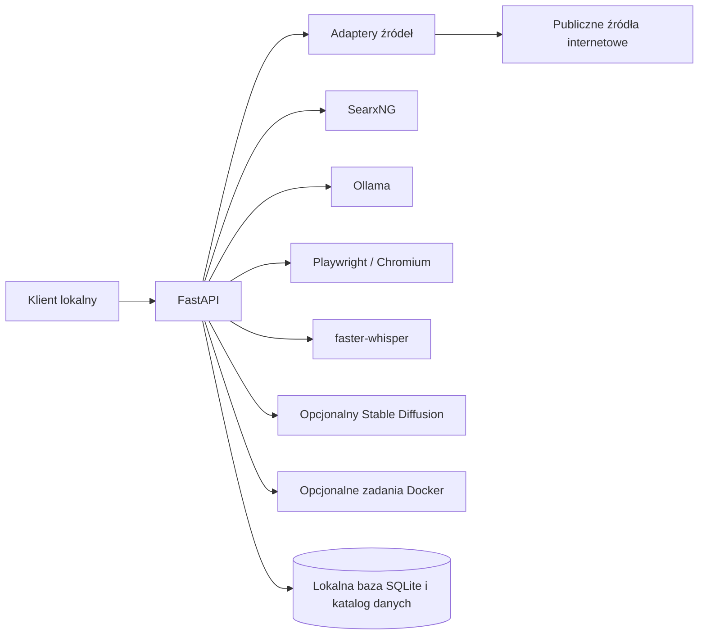

# n3xusAPI

## Jak to działa?

W skrócie:

1. Wysyłasz żądanie HTTP, np. z adresem strony do pobrania albo hasłem do wyszukania.
2. API wybiera odpowiednią funkcję i pobiera dane z publicznego źródła lub lokalnego narzędzia.
3. Dostajesz wynik w JSON razem ze statusem. Tam, gdzie to możliwe, odpowiedź podaje też źródło danych.

```text
Twoja aplikacja  →  n3xusAPI  →  źródło danych  →  odpowiedź JSON
```

## Uruchomienie

Potrzebujesz Node.js z npm oraz Dockera. W terminalu wykonaj:

```bash
git clone https://github.com/n3xus47/n3xus-api.git
cd n3xus-api
npm run setup
```

`npm run setup` tworzy `.env`, pobiera najnowsze obrazy Docker i skonfigurowany model Ollama, buduje API i uruchamia cały stos. Przy pierwszym uruchomieniu pobieranie może potrwać. Ponowne uruchomienie tej komendy sprawdza dostępność nowszych wersji; niezmienione warstwy i model nie są pobierane ponownie. Setup odświeża też konfigurację SearxNG, migruje poprzednią domyślną wartość `qwen3.5:27b` do szybszego `qwen3.5:4b` i pozostawia własny model bez zmian. Szybki `npm start` migruje poprzedni domyślny limit wyszukiwania z 5 wariantów do 3, bez pobierania obrazów ani modeli.

Do zwykłego, szybkiego uruchamiania już przygotowanego stosu użyj:

```bash
npm start
```

Ta komenda nie sprawdza aktualizacji, nie pobiera obrazów ani modeli i nie przebudowuje API. Skill używa tego samego szybkiego trybu, kiedy lokalne API nie odpowiada. Jeśli setup nie był jeszcze wykonany albo brakuje lokalnych obrazów/modelu, uruchom `npm run setup`.

Gdy API będzie gotowe, sprawdź je:

```bash
curl http://localhost:8000/v1/health
```

## Przykłady użycia

Każdy przykład można wkleić do terminala po uruchomieniu API. Żądania `POST` wymagają unikalnego `Idempotency-Key`; poniższe komendy tworzą go na podstawie bieżącego czasu. Jeśli w konfiguracji serwera ustawiono `N3XUS_API_API_KEY`, dodaj do każdego żądania `-H 'Authorization: Bearer <klucz>'` i zastąp `<klucz>` jego wartością.

### 1. Wyszukaj strony w sieci

```bash
curl -sS -X POST http://localhost:8000/v1/search/web \
  -H 'Content-Type: application/json' \
  -H "Idempotency-Key: demo-web-search-$(date +%s)" \
  -d '{"query":"FastAPI background tasks documentation","maxResults":5}'
```

W `output.results` znajdziesz tytuły, adresy i dostępne opisy znalezionych stron.

### 2. Pobierz stronę jako Markdown

```bash
curl -sS -X POST http://localhost:8000/v1/scrape/website \
  -H 'Content-Type: application/json' \
  -H "Idempotency-Key: demo-scrape-website-$(date +%s)" \
  -d '{"urls":"https://fastapi.tiangolo.com/tutorial/","contentFormat":"markdown","maxPages":1,"maxChars":15000}'
```

Odpowiedź zawiera pobraną treść, tytuł strony i informacje o źródle. `maxPages: 1` ogranicza pobieranie do wskazanej strony.

### 3. Zbierz źródła do researchu

```bash
curl -sS -X POST http://localhost:8000/v1/research/deep \
  -H 'Content-Type: application/json' \
  -H "Idempotency-Key: demo-research-$(date +%s)" \
  -d '{"query":"Jak FastAPI zaleca obsługiwać długie zadania w tle?","mode":"raw"}'
```

Tryb `raw` zwraca znalezione dowody i adresy stron bez wymagania lokalnego modelu Ollama.

### 4. Pobierz metadane repozytorium GitHub

```bash
curl -sS -X POST http://localhost:8000/v1/scrape/github/repo \
  -H 'Content-Type: application/json' \
  -H "Idempotency-Key: demo-github-repo-$(date +%s)" \
  -d '{"repository":"n3xus47/n3xus-api"}'
```

API zwraca publiczne metadane repozytorium; wynik zależy od dostępności GitHuba i jego limitów dla anonimowych żądań.

### 5. Znajdź miejsca według kategorii

```bash
curl -sS -X POST http://localhost:8000/v1/scrape/open-business/search \
  -H 'Content-Type: application/json' \
  -H "Idempotency-Key: demo-open-business-$(date +%s)" \
  -d '{"search":"electric vehicle charging station","location":"Warsaw, Poland","radiusMeters":5000,"maxItems":5}'
```

Kategorie, np. `coffee shop`, `restaurant`, `pharmacy` i ich obsługiwane polskie nazwy, są wyszukiwane w OpenStreetMap wokół podanej lokalizacji. `radiusMeters` ustawia promień w zakresie 1–50 km. Gdy Overpass jest niedostępny, API próbuje znaleźć miejsca przez Nominatim, a `source.collectionState` oznacza taką odpowiedź jako `partial` — wynik może nie zawierać wszystkich obiektów.

Wspólny format odpowiedzi opisuje pole `status`, właściwe dane w `output` oraz pochodzenie w `source`. Dokumentacja uruchomionego API: [Swagger UI](http://localhost:8000/docs) i [ReDoc](http://localhost:8000/redoc). Szczegółowy opis tras znajduje się w [referencji API](docs/api-reference.md).

## Skill dla agenta AI

Repozytorium zawiera skill [n3xusapi](.agents/skills/n3xusapi/SKILL.md). Agent korzystający ze skillów projektowych może przez niego uruchamiać API, wybierać właściwe trasy i interpretować źródła oraz ograniczenia wyników.

Skill odczytuje konfigurację klienta z procesu agenta:

| Zmienna | Domyślnie | Zastosowanie |
| --- | --- | --- |
| `N3XUS_API_BASE_URL` | `http://127.0.0.1:8000` | Adres API dostępny dla agenta. |
| `N3XUS_API_REPO` | wykrywany z lokalizacji skillu | Ścieżka do klonu repozytorium, z którego można uruchomić lokalny stos. |
| `N3XUS_API_API_KEY` | brak | Klucz klienta tylko wtedy, gdy serwer ma włączone uwierzytelnianie. |

Konfiguracja i procedura uruchomienia znajdują się w [instrukcji konfiguracji skillu](.agents/skills/n3xusapi/references/setup.md). Ustawienia serwera są osobne — opisuje je plik `.env.example`.

## Szczegóły

**n3xusAPI** to lokalne, samodzielnie hostowane API do wyszukiwania, pobierania i przetwarzania publicznych danych z internetu. Korzysta z adapterów źródłowych i lokalnych narzędzi, takich jak Ollama, Chromium, SQLite, faster-whisper i Docker.

### Co potrafi

- Pobiera treść publicznych stron jako tekst lub Markdown, może odwiedzać powiązane strony w ograniczonym zakresie i wyodrębnia metadane oraz obrazy.
- Wyszukuje w sieci za pomocą lokalnego SearxNG i DuckDuckGo, a następnie usuwa duplikaty i szereguje wyniki.
- Pobiera publiczne dane z GitHuba i YouTube przez adaptery dostosowane do tych źródeł oraz wyodrębnia tekst z publicznych plików PDF.
- Prowadzi badania oparte na źródłach i ekstrakcję zgodną ze schematem; opcjonalnie korzysta z lokalnego Ollama.
- Udostępnia adaptery stron publicznych dla serwisów społecznościowych, Amazona i otwartych katalogów firm. Wyszukiwanie firm obsługuje nazwy miejsc oraz kategorie, takie jak kawiarnie czy stacje ładowania EV, z lokalizacją i promieniem; używa OpenStreetMap, nie Google Places.
- Oferuje zadania w przeglądarce, ręcznie obsługiwane sesje przeglądarki, transkrypcję audio, generowanie obrazów i jednorazowe zadania w Dockerze.
- Zapisuje żądania, wyniki idempotentne, pliki pamięci i szkice/wiadomości e-mail w lokalnej bazie SQLite.

## Możliwości i poziomy wsparcia

`GET /v1/capabilities` zwraca aktualny rejestr możliwości. Można go filtrować, np. `GET /v1/capabilities?capability=scrape.github`. Każdy wpis zawiera `supportLevel`, `adapter`, `limitations` oraz, jeśli jest dostępne, `evaluationSuite`.

| Poziom wsparcia | Znaczenie |
| --- | --- |
| `structured` | Adapter zwraca znormalizowane rekordy specyficzne dla źródła. Źródło nadal może nie zwrócić części danych lub zablokować dostęp. |
| `best_effort` | Wynik pochodzi z publicznej strony lub ograniczonego interfejsu źródła i może być niepełny albo ogólny. |
| `experimental` | Wynik zależy od lokalnego modelu, planowania działań przeglądarki lub heurystyki ekstrakcji. |
| `unavailable` | Funkcja nie jest lokalnie zaimplementowana; API nie wymyśla brakujących danych. |

Poziom opisuje jakość kontraktu danych, a nie samo istnienie trasy. Przed użyciem wyniku sprawdź `limitations` danej możliwości. Na przykład trasa `scrape.google` jest aliasem zgodności obsługiwanym przez OpenStreetMap Nominatim — **nie zwraca danych Google Places**. Pełna analiza braków znajduje się w [audycie zgodności](docs/deepapi-parity-audit.md).

## Pochodzenie danych i stany pobierania

Udane odpowiedzi korzystające ze źródeł zewnętrznych mogą zawierać obiekt `source`. Podaje on adapter (`name`), użyte lub pobrane adresy URL (`urls`), czas pobrania (`retrievedAt`, UTC, ISO 8601) oraz `collectionState`:

| Stan | Znaczenie |
| --- | --- |
| `complete` | Adapter zebrał oczekiwane dane dla tego żądania. |
| `partial` | Nie udało się zebrać części oczekiwanych pól, stron lub materiałów źródłowych. |
| `blocked` | Źródło odmówiło dostępu, np. z powodu limitu lub CAPTCHA. |
| `empty` | Żądanie zakończyło się poprawnie, ale nie znaleziono pasujących rekordów. |

Pusty wynik ze stanem `status: "succeeded"` i `collectionState: "empty"` jest prawidłowym rezultatem, a nie błędem transportu. Brak `source` oznacza, że pochodzenie danych nie zostało jeszcze ujednolicone dla tej trasy — klient nie powinien go dopowiadać ani fabrykować.

## Format odpowiedzi, tryb próbny i ponawianie żądań

Większość operacji zwraca wspólny obiekt JSON:

```json
{
  "requestId": "local_…",
  "route": "/v1/search/web",
  "capability": "search.web",
  "status": "succeeded",
  "replayed": false,
  "costFinal": true,
  "debitMicrousd": 0,
  "output": { "results": [] },
  "source": {
    "name": "searxng+duckduckgo",
    "urls": [],
    "retrievedAt": "2026-01-01T00:00:00+00:00",
    "collectionState": "empty"
  }
}
```

Dokładny zestaw pól zależy od trasy. Błędy mają `status: "failed"` oraz obiekt `error` z kodem `code`, informacją `retryable` i wskazówką `hint`. Lokalne operacje nie naliczają opłat; udane odpowiedzi podają `debitMicrousd: 0`.

Każde żądanie `POST` obsługujące idempotencję wymaga unikalnego nagłówka `Idempotency-Key`, chyba że ustawiono `dryRun: true`. Powtórzenie tego samego klucza odtwarza zapisany wynik i ustawia `replayed: true`; do nowej operacji użyj nowego klucza. Tryb `dryRun` waliduje żądanie i zwraca `status: "dry_run"` bez uruchamiania pracy. Operacje `PUT`, `GET` i `DELETE` nie korzystają z mechanizmu idempotencji POST.

Jeśli ustawiono `N3XUS_API_API_KEY`, każda trasa poza `/v1/health` wymaga nagłówka `Authorization: Bearer <klucz>`.

## Architektura



API jest przeznaczone dla jednego zaufanego operatora lokalnego. Wykonywanie zadań Docker wymaga podłączenia `/var/run/docker.sock` i przyjmuje wyłącznie połączenia z loopback. Nie udostępniaj usługi niezaufanej sieci. Szczegóły: [limity wykonywania zadań Docker](docs/vm-isolation.md).

## Technologie

- Python 3.12, FastAPI, Pydantic Settings i Uvicorn
- SQLite do lokalnych żądań, pamięci i stanu poczty e-mail
- SearxNG i `ddgs` do wyszukiwania; adaptery publicznych źródeł dla GitHuba, YouTube, OpenStreetMap i innych stron
- Playwright/Chromium do stron renderowanych JavaScriptem i ograniczonych zadań przeglądarki
- Ollama do opcjonalnego lokalnego tworzenia podsumowań badań i ekstrakcji
- faster-whisper do lokalnej transkrypcji CPU; opcjonalny serwer generowania obrazów zgodny z AUTOMATIC1111
- Docker Compose do API i lokalnych usług
- Pytest i pytest-asyncio do testów Pythona; ustawienia Ruff znajdują się w `pyproject.toml`

## Wymagania i dodatkowe ustawienia uruchomienia

### Wymagania

- Docker Engine z Docker Compose 2.24 lub nowszym
- Node.js z npm, Docker Engine z Docker Compose 2.24 lub nowszym, `curl` i Bash
- Pamięć i miejsce na skonfigurowany model Ollama. Domyślny `qwen3.5:4b` jest mniejszy, aby lokalne zadania agenta startowały szybciej.

Aby użyć innego modelu Ollama przy uruchamianiu:

```bash
N3XUS_API_OLLAMA_MODEL=your-ollama-model npm run setup
```

Zastąp `your-ollama-model` identyfikatorem modelu dostępnym w Ollama. Przy kolejnym setupie ta sama komenda sprawdzi i pobierze najnowszą wersję wskazanego tagu.

Aktualizacje wykonuj jawnie przez `npm run setup`. Aby zatrzymać stos, użyj `docker compose down`. Po zmianach w kodzie API możesz przebudować wyłącznie jego obraz poleceniem `docker compose up --build -d api`.

Setup tworzy `.env` z `.env.example`, jeśli plik jeszcze nie istnieje. Edytuj `.env` na swojej maszynie; nie dodawaj go ani sekretów do repozytorium. Przy bezpośrednim uruchomieniu Compose możesz najpierw wykonać `cp .env.example .env`, jeśli chcesz zmienić konfigurację.

## Konfiguracja

Ustawienia serwera są przekazywane do kontenera API przez lokalny plik `.env`, przygotowany na podstawie [`.env.example`](.env.example). Dostępne opcjonalne ustawienia:

| Zmienna | Domyślnie | Zastosowanie |
| --- | --- | --- |
| `N3XUS_API_API_KEY` | brak | Włącza uwierzytelnianie Bearer; `/v1/health` pozostaje publiczne. |
| `N3XUS_API_DATA_DIR` | `data` | Katalog lokalnej bazy SQLite i innych danych. |
| `N3XUS_API_SEARXNG_URL` | `http://searxng:8080` | Adres SearxNG używany w sieci Compose. |
| `N3XUS_API_SEARCH_DDG_ENABLED` | `true` | Włącza DuckDuckGo jako źródło fuzji lub zapasowe. |
| `N3XUS_API_OLLAMA_URL` | `http://ollama:11434` | Adres usługi Ollama. |
| `N3XUS_API_OLLAMA_MODEL` | `qwen3.5:4b` | Lokalny model do badań i ekstrakcji; setup pobiera aktualną wersję skonfigurowanego tagu. |
| `N3XUS_API_SMTP_URL` | brak | Adres serwera SMTP do wysyłki e-maili. |
| `N3XUS_API_SMTP_FROM` | brak | Domyślny adres nadawcy przy tworzeniu lokalnej tożsamości e-mail. |
| `N3XUS_API_TRANSCRIPTION_MODEL` | `base` | Nazwa modelu faster-whisper. |
| `N3XUS_API_TRANSCRIPTION_DEVICE` | `cpu` | Urządzenie transkrypcji; CUDA wymaga zgodnego pakietu. |
| `N3XUS_API_STABLE_DIFFUSION_URL` | brak | Opcjonalny adres API lokalnej usługi zgodnej z AUTOMATIC1111. |
| `N3XUS_API_META_ADS_ACCESS_TOKEN` | brak | Opcjonalny token z dostępem do Meta Ads Library API. |
| `N3XUS_API_VM_HOST_DATA_DIR` | ustawiane przez Compose | Ścieżka hosta montowana dla plików tworzonych przez zadania Docker. |

Domyślne wartości w `.env.example` wystarczają do uruchomienia lokalnego stosu. Zewnętrzne usługi, takie jak SMTP, Meta Ads Library i serwer Stable Diffusion, wymagają własnej konfiguracji. Nie wpisuj ich sekretów do pliku przykładowego.

Zestaw Compose jest skonfigurowany do komunikacji po lokalnej sieci Dockera. Adresy takie jak `http://ollama:11434` są nazwami usług dostępnymi wewnątrz Compose, a nie z terminala hosta. Niektóre opcjonalne integracje wymagają dodatkowych usług lub uprawnień hosta; ich ograniczenia są widoczne w rejestrze możliwości.

## Ewaluacja jakości

Harness ewaluacyjny mierzy pokrycie wymaganych pól, opóźnienie i powody niepowodzeń dla publicznych fixture'ów. Nie potwierdza poprawności faktów i nie podnosi poziomu wsparcia możliwości.

```bash
docker compose up --build -d
npm run eval -- --fixtures evals/smoke.json --output docs/evals/latest.md
```

Domyślny adres API to `http://127.0.0.1:8000`. Narzędzie ewaluacyjne używa nowych kluczy idempotencji i oczekuje publicznych celów. Szczegóły opisuje [procedura ewaluacji](docs/evals/WORKFLOW.md); przykładowy raport znajduje się w [raporcie smoke](docs/evals/harness-smoke.md), a przykładowe dane żądań w katalogu [`evals/`](evals/).

## Układ repozytorium

| Ścieżka | Zawartość |
| --- | --- |
| `app/` | Trasy FastAPI, kontrakty żądań i odpowiedzi, adaptery oraz usługi lokalne |
| `docs/api-reference.md` | Opis tras i kontraktów API |
| `.agents/skills/n3xusapi/` | Skill agenta AI i instrukcje korzystania z API |
| `.env.example` | Przykładowa konfiguracja serwera API |
| `docs/` | Zasady, notatki operacyjne, audyty, migracje bazy i raporty ewaluacji |
| `evals/` | Fixture'y żądań do publicznych celów oraz metadane lokalnych próbek audio |
| `tests/` | Testy API, adapterów i kontraktów |
| `scripts/` | Skrypty uruchomieniowe i pomocnicze |
| `searxng/settings.yml` | Konfiguracja silników SearxNG |

## Ograniczenia i bezpieczeństwo

- Trasy pobierające dane z sieci przyjmują publiczne adresy HTTP(S) i odrzucają localhost oraz prywatne adresy sieciowe, również po przekierowaniu.
- Adaptery nie obchodzą logowania, CAPTCHA, limitów źródeł ani kontroli dostępu. Zablokowane źródło jest raportowane jako zablokowane lub puste; API nie fabrykuje rekordów.
- Sesje przeglądarki wymagają jawnego przekazania obsługi operatorowi. Operator wykonuje ewentualne logowanie w widocznym Chromium; API nie wpisuje danych logowania ani nie rozwiązuje CAPTCHA. Dane sesji zostają w lokalnym katalogu i są używane tylko po podaniu `browserSessionId`.
- `browser.act` ogranicza się do odczytu publicznych stron, linków, filtrów, sortowania, paginacji i wyszukiwania. Nie obsługuje logowania ani zakupów.
- `/v1/vm/run` uruchamia kontener Docker i wymaga dostępu do gniazda Dockera hosta. To gniazdo daje znaczną kontrolę nad hostem; trasa dodatkowo odrzuca klientów spoza loopback. Utrzymuj API dostępne wyłącznie lokalnie.
- Wysyłka e-mail wymaga skonfigurowanego przez operatora serwera SMTP i lokalnej tożsamości nadawcy. Weryfikacja e-mail sprawdza tylko składnię, a nie dostarczalność do skrzynki. Wyszukiwanie kontaktów zwraca wyłącznie jawnie opublikowane adresy i nigdy ich nie zgaduje.

Więcej informacji zawierają: [zasady weryfikacji e-mail](docs/email-verification-policy.md), [wysyłka e-mail](docs/email-delivery.md) oraz [limity wykonywania zadań Docker](docs/vm-isolation.md).
